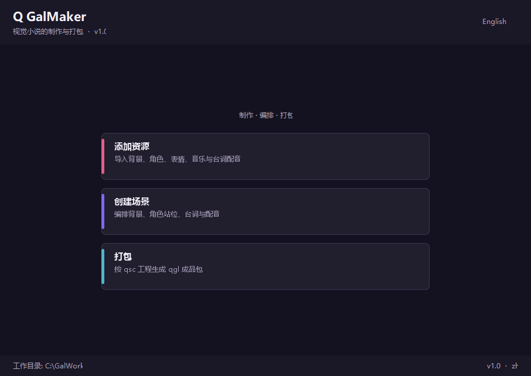
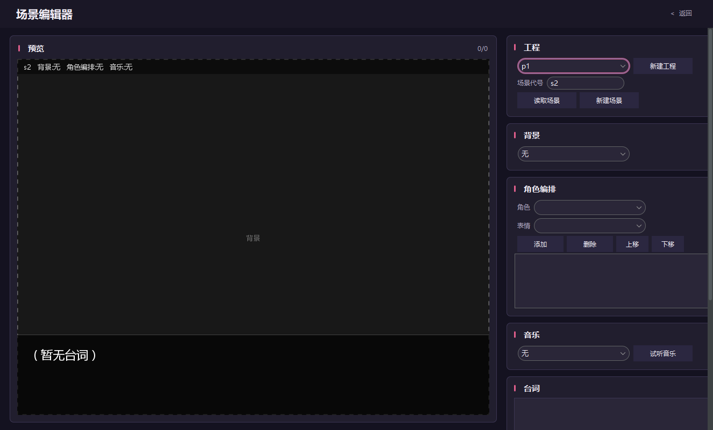
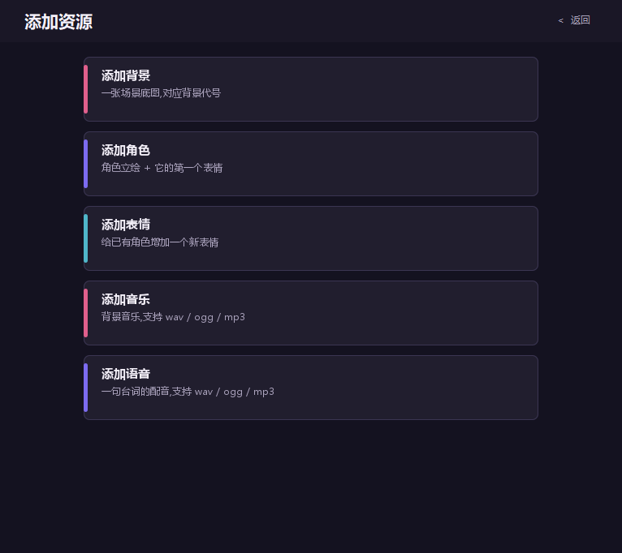
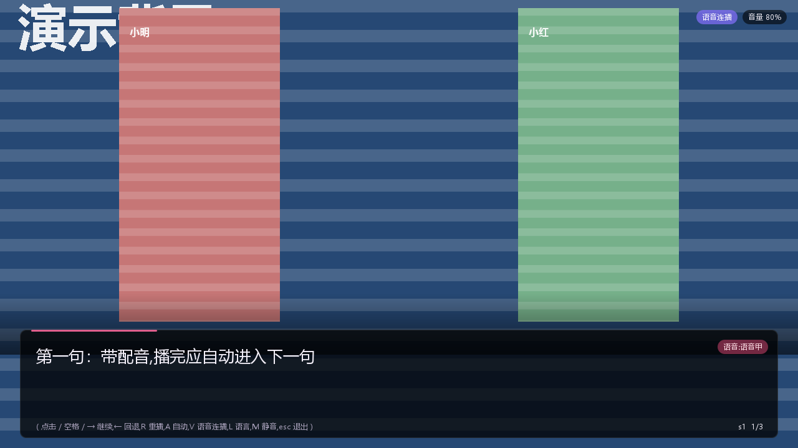
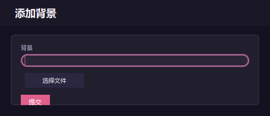
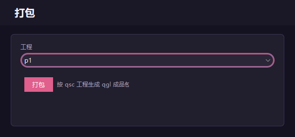
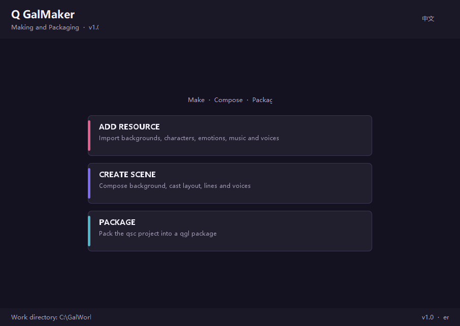

# QGal

视觉小说引擎 · 编辑器 + 播放器  
ビジュアルノベルエンジン · エディター + プレイヤー  
비주얼 노블 엔진 · 에디터 + 플레이어  
Движок визуальных новелл · Редактор + Плеер

`v1.0` · Windows x64 · 免安装 / Portable / インストール不要 / 무설치 / Портативная · **No Java required / 无需安装 Java**

[简体中文](#zh) · [日本語](#ja) · [한국어](#ko) · [English](#en) · [Русский](#ru)

---

## 截图 / Screenshots

| 编辑器首页 / Editor Home | 场景编辑器 / Scene Editor |
| --- | --- |
|  |  |

| 资源管理 / Resources | 播放器 / Player |
| --- | --- |
|  |  |

| 导入表单 / Import form | 打包 / Package | 英文界面 / English UI |
| --- | --- | --- |
|  |  |  |

---

<a id="zh"></a>

# 简体中文

**不用写代码,也能把视觉小说打包成可分发、可播放的成品。**

QGal 是一套**视觉小说制作与播放工具链**,由两个完全独立的工程组成:

- **QGalMaker(编辑器)** —— 导入素材、编排场景、实时预览、保存工程、打包成品
- **QGalPlayer(播放器)** —— 拆开成品包,还原背景 / 立绘 / 台词 / 配音 / 音乐并播放

两者之间**只通过一个文件格式(`.qgl`)通信**,不共享任何代码与目录,可以各自单独编译、单独分发。

## 运行原理

```
素材(背景图 / 立绘 / 音乐 / 配音)
   │  ① 添加资源:按"代号"归档
   ▼
GalWork/  Background · Character/<角色>/<表情> · Music · Voice
   │  ② 创建场景:选择元素 + 编排台词,左侧实时预览
   ▼
GalWork/Scenes/<工程>.qsc        一行一个场景:
   │                             s1{"bg教室";"小明:微笑,小红:害羞";"bgm_日常";["台词一","台词二"];["v1",""]}
   │  ③ 打包:按 .qsc 编排生成成品
   ▼
GalWork/Output/<工程>.qgl        zip 压缩包(每个场景一个文件夹 + 元素文件 + 文本说明)
   │  ④ 拆包播放:解压到临时目录 → 解析 → 渲染 → 播放
   ▼
画面 + 台词 + 语音 + 背景音乐
```

要点:

- **代号即资源名**:`GalWork/Background/bg教室.png` 的代号就是 `bg教室`,支持中文。
- **场景用一行文本描述**:背景只能一个、角色可多个且顺序即从左到右、台词按顺序播放、每句台词可挂一段配音。
- **成品是 zip**:容器就是标准 zip,后缀改成 `.qgl` 以标注文件特征;播放器解包到临时目录,关闭窗口自动清理。
- **运行时自带**:发布包内嵌精简 JRE(`jlink` + `jpackage`),目标电脑**不需要安装 Java**,双击 `exe` 即用。

## 主要功能

**编辑器 QGalMaker**

- 资源管理:背景、角色(+首个表情)、表情、音乐、配音,按代号导入并校验命名
- 场景编辑器:左侧**实时预览**(背景等比铺满、立绘从左到右居中、台词自动换行),右侧卡片式编排
- 台词与配音:台词列表可增删改与排序,每句可指派一段配音,支持试听
- 工程管理:一个工程可含多个场景,支持新建 / 读取 / 覆盖保存
- 中文友好:自动挑选可显示汉字的中文字体,中英混排换行(标点不落行首)
- 界面语言:中文 / English **热切换**,无需重启
- 一键打包:按 `.qsc` 编排输出 `.qgl`,并生成元素清单文本

**播放器 QGalPlayer**

- 拆包播放:自动解压、解析、容错(资源缺失或格式不支持都不会中断播放)
- 画面:背景、立绘(左→右排列、居中)、圆角台词框、状态标签
- 语音连播:一句配音播完自动进入下一句(**可开关**)
- 自动播放:定时推进(默认 2.5 秒)
- 音量与静音:两条独立音频通道(背景音乐循环 + 语音单次),可同时出声
- 键盘操作:推进、回退、重播、音量、静音、语言热切换一应俱全

**格式与音频**

- 成品格式 `.qgl`(zip),工程文本 `.qsc`(类 JSON 的紧凑文本)
- 音频:`wav` / `aiff` / `ogg` / `mp3`
- 兼容:旧版四段 `.qsc`(无配音字段)仍可直接读取

## 快速开始(使用者)

1. 下载 `QGalPlayer-1.0-win-x64-portable.zip`(或编辑器包)
2. 解压到任意目录(**目标电脑不需要安装 Java**)
3. 双击 `QGalPlayer.exe`
4. 选择成品 `.qgl`(或把 `.qgl` 直接拖到 exe 上)即可播放

> 绿色版:解压即用,不写注册表、不需要管理员权限。

## 使用教程

**① 制作(编辑器)**

1. 双击 `QGalMaker.exe` → **添加资源** → 依次导入背景图、角色立绘、音乐、配音(每项都要起一个代号,如 `bg教室`、`小明`、`微笑`、`v1`)
2. 回到首页 → **创建场景** → 新建工程(如 `p1`)→ 填场景代号(`s1`)→ 选背景 → 选角色与表情并"添加"(可多个,顺序即从左到右)→ 选音乐 → 输入台词并"添加"(可给每句指派配音)→ **保存场景**
3. 回到首页 → **打包** → 选择工程 → 生成 `GalWork/Output/p1.qgl`

**② 播放(播放器)**

| 操作 | 按键 |
| --- | --- |
| 推进台词 | 鼠标左键 / 空格 / 回车 / → |
| 回退台词 | ← / Backspace |
| 从头重播 | R |
| 自动播放 | A |
| 语音连播 | V |
| 静音 | M |
| 音量加减 | + / - |
| 界面语言 | L |
| 退出 | ESC |

## 成品格式

```
p1.qgl (zip)
├─ project.qsc                工程文件,决定场景播放顺序
├─ manifest.txt               元素清单(数量 / 分类 / 缺失提示)
└─ s1/                        每个场景一个文件夹
   ├─ scene.qsc               该场景的单场景文本
   ├─ scene.txt               元素说明(分类与出现顺序)
   ├─ Background/bg教室.png
   ├─ Character/1_小明_微笑.png      文件名序号 = 从左到右的顺序
   ├─ Music/bgm_日常.ogg
   └─ Voice/1_v1.mp3                文件名序号 = 所属台词的顺序
```

场景文本语法:

```
s1{"背景代号";"角色:表情,角色:表情";"音乐代号";["台词一","台词二"];["v1",""]}
```

第五段(配音)可省略;台词里的 `\` `"` 与换行需转义为 `\\` `\"` `\n`。

## 从源码构建

需要 **JDK 17+** 与 **Maven 3.6+**:

```bash
cd QGalMaker && mvn clean package     # 编辑器
cd ../QGalPlayer && mvn clean package # 播放器
```

产物:

| 路径 | 说明 |
| --- | --- |
| `target/*.jar` | 自包含 fat jar,可 `java -jar` 运行 |
| `target/dist/<名称>/<名称>.exe` | 免安装应用(自带运行时),双击即运行 |
| `target/dist/<名称>-<版本>-portable.zip` | 绿色分发包(约 29 MB) |

自检入口(发布门禁用,退出码 0 即可发布):

```bash
QGalMaker.exe --selftest           # 中文 / 字体 / 换行 / 编解码 / 打包
QGalPlayer.exe --selftest          # 中文 / 字体 / mp3+ogg 解码
QGalPlayer.exe --check 成品.qgl    # 拆包、资源、语音、渲染、清理
```

## 发布

主目录下的 `release.ps1` 完成"构建 → 门禁自检 → 归档改名 → 校验和 → 发布说明":

```powershell
.\release.ps1              # 两个工程全量构建并归档到 release/<版本>/
.\release.ps1 -Installer   # 顺带生成 Windows 安装包(需 WiX 或 Inno Setup)
```

## 系统要求与已知限制

- 系统:**Windows 10/11 x64**(其他平台需在对应系统上自行构建)
- 运行环境:自带 JRE,**无需安装 Java**
- 体积:压缩包约 29 MB,解压后约 43 MB
- 已知限制:
  - 素材目录 `GalWork` 目前位于**当前盘符根目录**(如 `C:\GalWork`),后续版本将改为可配置
  - `mp3` 循环播放有极小接缝,循环背景音乐建议用 `ogg` / `wav`
  - 个别非标准 `ogg` 文件可能无法解码,此时会提示并跳过,不影响画面与流程
  - 仅提供 Windows 构建产物

## 目录结构

```
QGal/
├─ QGalMaker/            编辑器(Maven 工程)
├─ QGalPlayer/           播放器(Maven 工程)
├─ release/<版本>/       发布产物(zip / msi / SHA256SUMS.txt / RELEASE_NOTES.md)
├─ docs/screenshots/     截图
├─ release.ps1           一键发布脚本
└─ README.md             本文件
```

## 许可

© Nierqiaodov · 许可协议待补充(请在公开发布前添加 `LICENSE` 文件)。

---

<a id="ja"></a>

# 日本語

**コードを書かずに、ビジュアルノベルを配布できる形にパッケージ。**

QGal は**ビジュアルノベル制作・再生ツールチェーン**です。完全に独立した 2 つのプロジェクトで構成されています。

- **QGalMaker(エディター)** — 素材の読み込み、シーン構成、リアルタイムプレビュー、プロジェクト保存、パッケージ出力
- **QGalPlayer(プレイヤー)** — パッケージを展開し、背景・立ち絵・台詞・ボイス・BGM を再生

両者は**ファイル形式(`.qgl`)だけで連携**しており、コードもディレクトリも共有しません。個別にビルド・配布できます。

## 動作原理

```
素材(背景画像 / 立ち絵 / BGM / ボイス)
   │  ① 素材を追加:「コード」で管理
   ▼
GalWork/  Background · Character/<キャラ>/<表情> · Music · Voice
   │  ② シーン作成:要素を選択し台詞を並べる(左側でリアルタイムプレビュー)
   ▼
GalWork/Scenes/<プロジェクト>.qsc   1 行 = 1 シーン:
   │                                s1{"bg教室";"小明:微笑,小红:害羞";"bgm_日常";["台詞1","台詞2"];["v1",""]}
   │  ③ パッケージ:qsc の構成に従って出力
   ▼
GalWork/Output/<プロジェクト>.qgl   zip アーカイブ(シーンごとに 1 フォルダ + 素材 + テキスト説明)
   │  ④ 展開して再生:一時ディレクトリへ解凍 → 解析 → 描画 → 再生
   ▼
映像 + 台詞 + ボイス + BGM
```

ポイント:

- **コード = 素材名**:`GalWork/Background/bg教室.png` のコードは `bg教室`。日本語・中国語も使用可。
- **シーンは 1 行のテキスト**:背景は 1 つのみ、キャラは複数可(並び順 = 左から右)、台詞は順番に再生、台詞ごとにボイスを割り当て可能。
- **完成品は zip**:コンテナは標準 zip のまま、拡張子のみ `.qgl` に変更。プレイヤーは一時ディレクトリへ展開し、終了時に自動削除。
- **ランタイム同梱**:配布パッケージに縮小 JRE(`jlink` + `jpackage`)を内蔵。**Java のインストールは不要**、`exe` をダブルクリックするだけ。

## 主な機能

**エディター QGalMaker**

- 素材管理:背景、キャラ(＋最初の表情)、表情、BGM、ボイスをコード付きで取り込み・検証
- シーンエディター:左に**リアルタイムプレビュー**(背景は画面全体に拡大、立ち絵は左から右へ中央揃え、台詞は自動折り返し)、右にカード型の操作パネル
- 台詞とボイス:台詞の追加・編集・削除・並べ替え、台詞ごとのボイス割り当て、試聴
- プロジェクト管理:1 プロジェクトに複数シーン、新規作成 / 読み込み / 上書き保存
- CJK 対応:漢字を表示できるフォントを自動選択、禁則処理付き折り返し
- UI 言語:中国語 / English を**再起動なしで切替**
- ワンクリックパッケージ:`.qsc` から `.qgl` を生成し、要素一覧テキストも出力

**プレイヤー QGalPlayer**

- 展開再生:自動解凍・解析・寛容な処理(素材欠落や未対応形式でも再生は継続)
- 描画:背景、立ち絵(左→右・中央揃え)、角丸の台詞ウィンドウ、ステータス表示
- ボイス連続再生:ボイス終了後に自動で次の台詞へ(**ON/OFF 可**)
- 自動再生:一定間隔で進行(既定 2.5 秒)
- 音量・ミュート:独立した 2 チャンネル(BGM ループ + ボイス単発)を同時再生
- キーボード操作:進行・戻る・リプレイ・音量・ミュート・言語切替

**形式とオーディオ**

- 完成品 `.qgl`(zip)、プロジェクトテキスト `.qsc`(JSON 風の簡潔な書式)
- 音声:`wav` / `aiff` / `ogg` / `mp3`
- 互換:旧形式の 4 セクション `.qsc`(ボイスなし)も読み込み可能

## クイックスタート

1. `QGalPlayer-1.0-win-x64-portable.zip`(またはエディター版)をダウンロード
2. 任意のフォルダに解凍(**Java のインストールは不要**)
3. `QGalPlayer.exe` をダブルクリック
4. `.qgl` を選択(または exe にドロップ)して再生

## 使い方

**① 制作(エディター)**

1. `QGalMaker.exe` を起動 → **素材を追加** → 背景・立ち絵・BGM・ボイスを順に取り込む(それぞれコードを付ける:例 `bg教室`、`小明`、`微笑`、`v1`)
2. ホームに戻り **シーン作成** → 新規プロジェクト(`p1` など)→ シーンコード(`s1`)→ 背景 → キャラと表情を選択して「追加」(複数可、順序 = 左から右)→ BGM → 台詞を入力して「追加」(ボイスも指定可)→ **シーン保存**
3. ホームに戻り **パッケージ** → プロジェクトを選択 → `GalWork/Output/p1.qgl` を生成

**② 再生(プレイヤー)**

| 操作 | キー |
| --- | --- |
| 次へ | 左クリック / Space / Enter / → |
| 戻る | ← / Backspace |
| 最初から | R |
| 自動再生 | A |
| ボイス連続再生 | V |
| ミュート | M |
| 音量 | + / - |
| UI 言語 | L |
| 終了 | ESC |

## 完成品フォーマット

```
p1.qgl (zip)
├─ project.qsc                プロジェクトファイル(シーンの再生順)
├─ manifest.txt               要素一覧(数・分類・欠落通知)
└─ s1/                        シーンごとに 1 フォルダ
   ├─ scene.qsc               そのシーンのテキスト
   ├─ scene.txt               要素の説明(分類と順序)
   ├─ Background/bg教室.png
   ├─ Character/1_小明_微笑.png      連番 = 左からの順序
   ├─ Music/bgm_日常.ogg
   └─ Voice/1_v1.mp3                連番 = 対応する台詞の順序
```

シーン記法:

```
s1{"背景コード";"キャラ:表情,キャラ:表情";"音楽コード";["台詞1","台詞2"];["v1",""]}
```

第 5 セクション(ボイス)は省略可。台詞内の `\` `"` と改行は `\\` `\"` `\n` にエスケープします。

## ソースからビルド

**JDK 17+** と **Maven 3.6+** が必要です。

```bash
cd QGalMaker && mvn clean package     # エディター
cd ../QGalPlayer && mvn clean package # プレイヤー
```

出力:

| パス | 内容 |
| --- | --- |
| `target/*.jar` | 依存を含む fat jar(`java -jar` で起動可) |
| `target/dist/<名称>/<名称>.exe` | インストール不要のアプリ(ランタイム同梱) |
| `target/dist/<名称>-<バージョン>-portable.zip` | ポータブル配布物(約 29 MB) |

セルフチェック(リリース判定用 / 終了コード 0 で合格):

```bash
QGalMaker.exe --selftest
QGalPlayer.exe --selftest
QGalPlayer.exe --check パッケージ.qgl
```

## リリース

`release.ps1` が「ビルド → セルフチェック → 名称統一でアーカイブ → ハッシュ → リリースノート」を実行します。

```powershell
.\release.ps1
```

## 動作環境と既知の制限

- OS:**Windows 10/11 x64**(他プラットフォームは各 OS 上でビルドが必要)
- **Java のインストール不要**(JRE 同梱)/ 約 29 MB(展開後 約 43 MB)
- 既知の制限:
  - 素材フォルダ `GalWork` は現状**ドライブ直下**(例 `C:\GalWork`)。今後設定可能に変更予定
  - `mp3` のループには微小な継ぎ目。BGM のループには `ogg` / `wav` を推奨
  - 一部の非標準 `ogg` はデコードできない場合あり(その場合スキップして再生継続)
  - 配布物は Windows 版のみ

## ディレクトリ構成

```
QGal/
├─ QGalMaker/            エディター(Maven)
├─ QGalPlayer/           プレイヤー(Maven)
├─ release/<version>/    配布物(zip / msi / SHA256SUMS.txt / RELEASE_NOTES.md)
├─ docs/screenshots/     スクリーンショット
├─ release.ps1           リリーススクリプト
└─ README.md             このファイル
```

## ライセンス

© Nierqiaodov · ライセンスは未定(公開前に `LICENSE` を追加してください)。

---

<a id="ko"></a>

# 한국어

**코드 없이 비주얼 노블을 배포 가능한 형태로 패키징.**

QGal 은 **비주얼 노블 제작·재생 도구 체인**입니다. 완전히 독립된 두 프로젝트로 구성됩니다.

- **QGalMaker(에디터)** — 리소스 가져오기, 장면 구성, 실시간 미리보기, 프로젝트 저장, 패키지 생성
- **QGalPlayer(플레이어)** — 패키지를 풀어 배경·입화·대사·보이스·BGM 을 재생

두 프로젝트는 **파일 형식(`.qgl`)으로만 연결**되며 코드와 디렉터리를 공유하지 않습니다. 각각 독립적으로 빌드·배포할 수 있습니다.

## 동작 원리

```
리소스(배경 이미지 / 입화 / BGM / 보이스)
   │  ① 리소스 추가: "코드"로 관리
   ▼
GalWork/  Background · Character/<캐릭터>/<표정> · Music · Voice
   │  ② 장면 작성: 요소 선택 + 대사 배치(왼쪽 실시간 미리보기)
   ▼
GalWork/Scenes/<프로젝트>.qsc    한 줄 = 한 장면:
   │                             s1{"bg教室";"小明:微笑,小红:害羞";"bgm_日常";["대사1","대사2"];["v1",""]}
   │  ③ 패키지: qsc 구성에 따라 출력
   ▼
GalWork/Output/<프로젝트>.qgl   zip 압축 파일(장면별 폴더 + 리소스 + 텍스트 설명)
   │  ④ 압축 해제 후 재생: 임시 폴더로 풀기 → 파싱 → 렌더링 → 재생
   ▼
화면 + 대사 + 보이스 + BGM
```

핵심:

- **코드 = 리소스 이름**: `GalWork/Background/bg教室.png` 의 코드는 `bg教室`. 한글·중국어·일본어 모두 사용 가능.
- **장면은 한 줄의 텍스트**: 배경은 1개만, 캐릭터는 여러 개(순서 = 왼쪽→오른쪽), 대사는 순서대로 재생, 대사마다 보이스 지정 가능.
- **결과물은 zip**: 컨테이너는 표준 zip 그대로, 확장자만 `.qgl` 로 변경. 플레이어는 임시 폴더에 풀고 종료 시 자동 삭제.
- **런타임 포함**: 배포 패키지에 축소 JRE(`jlink` + `jpackage`)를 내장. **Java 설치 불필요**, `exe` 더블클릭으로 실행.

## 주요 기능

**에디터 QGalMaker**

- 리소스 관리: 배경, 캐릭터(+첫 표정), 표정, BGM, 보이스를 코드와 함께 가져오고 검증
- 장면 에디터: 왼쪽은 **실시간 미리보기**(배경은 화면 채움, 입화는 왼쪽→오른쪽 중앙 정렬, 대사는 자동 줄바꿈), 오른쪽은 카드형 조작 패널
- 대사와 보이스: 대사 추가·수정·삭제·순서 변경, 대사별 보이스 지정, 미리 듣기
- 프로젝트 관리: 한 프로젝트에 여러 장면, 생성/불러오기/덮어쓰기 저장
- CJK 지원: 한자를 표시할 수 있는 글꼴 자동 선택, 금칙 처리 줄바꿈
- UI 언어: 중국어 / English **재시작 없이 전환**
- 원클릭 패키지: `.qsc` 구성으로 `.qgl` 생성 + 요소 목록 텍스트 출력

**플레이어 QGalPlayer**

- 압축 해제 재생: 자동 해제·파싱·관용 처리(리소스 누락, 미지원 형식이어도 재생 지속)
- 화면: 배경, 입화(왼쪽→오른쪽·중앙 정렬), 둥근 대사창, 상태 표시
- 보이스 연속 재생: 보이스 종료 후 자동으로 다음 대사(**켜고 끌 수 있음**)
- 자동 재생: 일정 간격 진행(기본 2.5초)
- 볼륨·음소거: 독립된 두 채널(BGM 반복 + 보이스 단발) 동시 출력
- 키보드 조작: 진행·되돌리기·다시보기·볼륨·음소거·언어 전환

**형식과 오디오**

- 결과물 `.qgl`(zip), 프로젝트 텍스트 `.qsc`(JSON 유사 간결 형식)
- 오디오: `wav` / `aiff` / `ogg` / `mp3`
- 호환: 구형 4구간 `.qsc`(보이스 없음)도 읽기 가능

## 빠른 시작

1. `QGalPlayer-1.0-win-x64-portable.zip`(또는 에디터 패키지) 다운로드
2. 원하는 폴더에 압축 해제(**Java 설치 불필요**)
3. `QGalPlayer.exe` 더블클릭
4. `.qgl` 선택(또는 exe 로 드래그) 후 재생

## 사용 방법

**① 제작(에디터)**

1. `QGalMaker.exe` 실행 → **리소스 추가** → 배경, 입화, BGM, 보이스 순서로 가져오기(각각 코드 지정: 예 `bg教室`, `小明`, `微笑`, `v1`)
2. 홈으로 → **장면 만들기** → 새 프로젝트(`p1`)→ 장면 코드(`s1`)→ 배경 → 캐릭터·표정 선택 후 "추가"(여러 개 가능, 순서 = 왼쪽→오른쪽) → BGM → 대사 입력 후 "추가"(보이스 지정 가능) → **장면 저장**
3. 홈으로 → **패키지** → 프로젝트 선택 → `GalWork/Output/p1.qgl` 생성

**② 재생(플레이어)**

| 동작 | 키 |
| --- | --- |
| 다음 대사 | 마우스 왼쪽 / Space / Enter / → |
| 이전 대사 | ← / Backspace |
| 처음부터 | R |
| 자동 재생 | A |
| 보이스 연속 | V |
| 음소거 | M |
| 볼륨 | + / - |
| UI 언어 | L |
| 종료 | ESC |

## 결과물 형식

```
p1.qgl (zip)
├─ project.qsc                프로젝트 파일(장면 재생 순서)
├─ manifest.txt               요소 목록(수량·분류·누락 알림)
└─ s1/                        장면별 폴더
   ├─ scene.qsc               해당 장면 텍스트
   ├─ scene.txt               요소 설명(분류와 순서)
   ├─ Background/bg教室.png
   ├─ Character/1_小明_微笑.png      번호 = 왼쪽부터의 순서
   ├─ Music/bgm_日常.ogg
   └─ Voice/1_v1.mp3               번호 = 해당 대사의 순서
```

장면 표기:

```
s1{"배경코드";"캐릭터:표정,캐릭터:표정";"음악코드";["대사1","대사2"];["v1",""]}
```

다섯 번째 구간(보이스)은 생략 가능. 대사 내부의 `\` `"` 와 줄바꿈은 `\\` `\"` `\n` 으로 이스케이프합니다.

## 소스에서 빌드

**JDK 17+**, **Maven 3.6+** 필요:

```bash
cd QGalMaker && mvn clean package     # 에디터
cd ../QGalPlayer && mvn clean package # 플레이어
```

산출물:

| 경로 | 설명 |
| --- | --- |
| `target/*.jar` | 의존성을 포함한 fat jar(`java -jar` 실행 가능) |
| `target/dist/<이름>/<이름>.exe` | 설치 불필요 앱(런타임 내장) |
| `target/dist/<이름>-<버전>-portable.zip` | 포터블 배포본(약 29 MB) |

자체 점검(릴리스 게이트, 종료 코드 0 이면 통과):

```bash
QGalMaker.exe --selftest
QGalPlayer.exe --selftest
QGalPlayer.exe --check 패키지.qgl
```

## 릴리스

`release.ps1` 이 "빌드 → 자체 점검 → 이름 정리 후 보관 → 해시 → 릴리스 노트"를 수행합니다.

```powershell
.\release.ps1
```

## 시스템 요구 사항과 알려진 제한

- OS: **Windows 10/11 x64**(다른 플랫폼은 해당 OS 에서 빌드 필요)
- **Java 설치 불필요**(JRE 내장) / 약 29 MB(압축 해제 후 약 43 MB)
- 알려진 제한:
  - 리소스 폴더 `GalWork` 는 현재 **드라이브 루트**(예 `C:\GalWork`). 추후 설정 가능하도록 변경 예정
  - `mp3` 반복 재생에는 미세한 이음새가 있음. BGM 반복에는 `ogg` / `wav` 권장
  - 일부 비표준 `ogg` 파일은 디코딩 실패 가능(이 경우 건너뛰고 계속 재생)
  - 배포물은 Windows 빌드만 제공

## 디렉터리 구조

```
QGal/
├─ QGalMaker/            에디터(Maven)
├─ QGalPlayer/           플레이어(Maven)
├─ release/<버전>/       배포물(zip / msi / SHA256SUMS.txt / RELEASE_NOTES.md)
├─ docs/screenshots/     스크린샷
├─ release.ps1           릴리스 스크립트
└─ README.md             이 문서
```

## 라이선스

© Nierqiaodov · 라이선스 미정(공개 전에 `LICENSE` 파일을 추가하세요).

---

<a id="en"></a>

# English

**Package your visual novel without codes.**

QGal is a **visual novel toolchain** made of two fully independent projects:

- **QGalMaker (editor)** — import assets, compose scenes, live preview, save projects, build packages
- **QGalPlayer (player)** — unpack a package and play background, sprites, lines, voice and music

The two only talk through **one file format (`.qgl`)**. No shared code, no shared folders — you can build and ship either one on its own.

## How it works

```
Assets (backgrounds / sprites / music / voice)
   │  ① ADD RESOURCE: imported under a short "code"
   ▼
GalWork/  Background · Character/<character>/<emotion> · Music · Voice
   │  ② CREATE SCENE: pick elements, arrange lines (live preview on the left)
   ▼
GalWork/Scenes/<project>.qsc     one line per scene:
   │                             s1{"bgRoom";"Ming:smile,Hong:shy";"bgmDaily";["Line 1","Line 2"];["v1",""]}
   │  ③ PACKAGE: layout driven by the .qsc
   ▼
GalWork/Output/<project>.qgl     a zip archive (one folder per scene + asset files + text manifest)
   │  ④ UNPACK & PLAY: extract to a temp dir → parse → render → play
   ▼
Picture + lines + voice + BGM
```

Key points:

- **Code = asset name.** `GalWork/Background/bgRoom.png` has the code `bgRoom`. Chinese, Japanese and Korean codes all work.
- **A scene is one line of text.** Exactly one background, any number of characters (order = left to right), lines play in order, each line can carry one voice clip.
- **The package is a zip.** Plain zip container, renamed to `.qgl` to mark the file type. The player extracts to a temp directory and cleans it up on exit.
- **Runtime included.** The distributable embeds a trimmed JRE (`jlink` + `jpackage`), so **no Java installation is needed** — just double-click the `exe`.

## Features

**Editor — QGalMaker**

- Asset management: backgrounds, characters (plus the first emotion), emotions, music, voice — imported by code with validation
- Scene editor: **live preview** on the left (background covers the frame, sprites are laid out left to right and centred, lines wrap automatically); card-based controls on the right
- Lines & voice: add / edit / remove / reorder lines, attach a voice clip per line, preview audio
- Project management: many scenes per project, create / load / overwrite-save
- CJK-friendly: picks a font that can display Chinese characters; line-breaking keeps punctuation off the start of a line
- UI language: Chinese / English, **hot-switched without restarting**
- One-click packaging: `.qsc` → `.qgl`, plus a generated plain-text manifest

**Player — QGalPlayer**

- Unpack & play: automatic extraction, parsing and error tolerance (a missing asset or unsupported format never stops playback)
- Rendering: background, sprites (left to right, centred), rounded dialogue box, status pills
- Voice auto-advance: continues to the next line when a voice clip ends (**toggleable**)
- Auto-play: timed advance (2.5 s by default)
- Volume & mute: two independent channels (looping BGM + one-shot voice) that can play simultaneously
- Keyboard control: advance, back, restart, volume, mute, language switch

**Format & audio**

- Package: `.qgl` (zip); project text: `.qsc` (compact, JSON-like)
- Audio: `wav` / `aiff` / `ogg` / `mp3`
- Compatibility: legacy 4-section `.qsc` files (no voice field) still load

## Quick start

1. Download `QGalPlayer-1.0-win-x64-portable.zip` (or the editor package)
2. Extract anywhere (**no Java installation required**)
3. Double-click `QGalPlayer.exe`
4. Pick a `.qgl` package (or drop it onto the exe)

> Portable build: no installer, no registry writes, no administrator rights.

## Tutorial

**① Authoring (editor)**

1. Run `QGalMaker.exe` → **ADD RESOURCE** → import a background, a character sprite, music and voice files (each needs a code, e.g. `bgRoom`, `Ming`, `smile`, `v1`)
2. Back home → **CREATE SCENE** → new project (e.g. `p1`) → scene code (`s1`) → background → pick character and emotion and "add" (multiple allowed, order = left to right) → music → type a line and "add" (voice optional) → **SAVE SCENE**
3. Back home → **PACKAGE** → choose the project → `GalWork/Output/p1.qgl`

**② Playing (player)**

| Action | Key |
| --- | --- |
| Next line | Left click / Space / Enter / → |
| Previous line | ← / Backspace |
| Restart | R |
| Auto-play | A |
| Voice auto-advance | V |
| Mute | M |
| Volume | + / - |
| UI language | L |
| Quit | ESC |

## Package format

```
p1.qgl (zip)
├─ project.qsc                project file — defines scene play order
├─ manifest.txt               element manifest (counts, categories, missing warnings)
└─ s1/                        one folder per scene
   ├─ scene.qsc               the scene text
   ├─ scene.txt               element description (categories and order)
   ├─ Background/bgRoom.png
   ├─ Character/1_Ming_smile.png    leading number = left-to-right order
   ├─ Music/bgmDaily.ogg
   └─ Voice/1_v1.mp3                leading number = the line it belongs to
```

Scene syntax:

```
s1{"backgroundCode";"character:emotion,character:emotion";"musicCode";["Line 1","Line 2"];["v1",""]}
```

The fifth section (voice) is optional. Inside lines, `\`, `"` and newlines are escaped as `\\`, `\"`, `\n`.

## Building from source

Requires **JDK 17+** and **Maven 3.6+**:

```bash
cd QGalMaker && mvn clean package     # editor
cd ../QGalPlayer && mvn clean package # player
```

Outputs:

| Path | Contents |
| --- | --- |
| `target/*.jar` | self-contained fat jar (`java -jar` works) |
| `target/dist/<name>/<name>.exe` | installer-free app with bundled runtime |
| `target/dist/<name>-<version>-portable.zip` | portable distribution (~29 MB) |

Self-check entry points (used as the release gate — exit code 0 means pass):

```bash
QGalMaker.exe --selftest           # i18n / font / wrapping / codec / packaging
QGalPlayer.exe --selftest          # i18n / font / mp3+ogg decoders
QGalPlayer.exe --check package.qgl # unpack, assets, voice, render, cleanup
```

## Release

`release.ps1` in the repository root does "build → gate → archive & rename → checksums → release notes":

```powershell
.\release.ps1              # build everything into release/<version>/
.\release.ps1 -Installer   # also build a Windows installer (needs WiX or Inno Setup)
```

## Requirements & known limitations

- OS: **Windows 10/11 x64** (other platforms must be built on the matching OS)
- Runtime: bundled JRE, **no Java installation needed**
- Size: ~29 MB zipped, ~43 MB extracted
- Known limitations:
  - The asset folder `GalWork` currently lives at **the root of the current drive** (e.g. `C:\GalWork`); a configurable location is planned
  - `mp3` looping has a tiny seam — prefer `ogg` / `wav` for looping BGM
  - Some non-standard `ogg` files may fail to decode; playback skips them and continues
  - Only Windows artifacts are provided

## Repository layout

```
QGal/
├─ QGalMaker/            editor (Maven project)
├─ QGalPlayer/           player (Maven project)
├─ release/<version>/    release artifacts (zip / msi / SHA256SUMS.txt / RELEASE_NOTES.md)
├─ docs/screenshots/     screenshots
├─ release.ps1           one-click release script
└─ README.md             this file
```

## License

© Nierqiaodov · License TBD (please add a `LICENSE` file before publishing).

---

<a id="ru"></a>

# Русский

**Соберите визуальную новеллу в готовый к распространению пакет — без кода.**

QGal — это **инструментарий для создания и проигрывания визуальных новелл**, состоящий из двух полностью независимых проектов:

- **QGalMaker (редактор)** — импорт ресурсов, компоновка сцен, живой предпросмотр, сохранение проектов, сборка пакета
- **QGalPlayer (плеер)** — распаковка пакета и воспроизведение фона, спрайтов, реплик, озвучки и музыки

Проекты связаны **только форматом файла (`.qgl`)**, не имеют общего кода и общих каталогов, собираются и поставляются по отдельности.

## Принцип работы

```
Ресурсы (фоны / спрайты / музыка / озвучка)
   │  ① ДОБАВИТЬ РЕСУРС: импорт под коротким «кодом»
   ▼
GalWork/  Background · Character/<персонаж>/<эмоция> · Music · Voice
   │  ② СОЗДАТЬ СЦЕНУ: выбрать элементы и расставить реплики (живой предпросмотр слева)
   ▼
GalWork/Scenes/<проект>.qsc      одна строка = одна сцена:
   │                             s1{"bgRoom";"Ming:smile,Hong:shy";"bgmDaily";["Реплика 1","Реплика 2"];["v1",""]}
   │  ③ ПАКЕТ: компоновка по данным .qsc
   ▼
GalWork/Output/<проект>.qgl      zip-архив (папка на сцену + файлы ресурсов + текстовый манифест)
   │  ④ РАСПАКОВАТЬ И ИГРАТЬ: распаковка во временный каталог → разбор → отрисовка → воспроизведение
   ▼
Изображение + реплики + озвучка + музыка
```

Главное:

- **Код = имя ресурса.** У `GalWork/Background/bgRoom.png` код `bgRoom`. Коды могут содержать кириллицу, CJK и т. п.
- **Сцена — одна строка текста.** Ровно один фон, любое число персонажей (порядок = слева направо), реплики идут по порядку, к каждой можно привязать озвучку.
- **Пакет — это zip.** Контейнер обычный zip, переименованный в `.qgl`. Плеер распаковывает во временный каталог и удаляет его при закрытии.
- **Среда выполнения включена.** В дистрибутив встроен урезанный JRE (`jlink` + `jpackage`), поэтому **Java устанавливать не нужно** — достаточно дважды щёлкнуть `exe`.

## Возможности

**Редактор — QGalMaker**

- Управление ресурсами: фоны, персонажи (и первая эмоция), эмоции, музыка, озвучка — импорт по коду с проверками
- Редактор сцены: **живой предпросмотр** слева (фон заполняет экран, спрайты выстраиваются слева направо по центру, реплики переносятся автоматически), карточные панели справа
- Реплики и озвучка: добавление / изменение / удаление / перестановка, озвучка для каждой реплики, прослушивание
- Проекты: несколько сцен в одном проекте, создание / загрузка / сохранение с перезаписью
- Поддержка CJK: авто-выбор шрифта с иероглифами, перенос без запрещённых знаков в начале строки
- Язык интерфейса: китайский / English, **переключение без перезапуска**
- Пакет в один клик: `.qsc` → `.qgl` плюс текстовый манифест

**Плеер — QGalPlayer**

- Распаковка и воспроизведение: автоматическая распаковка, разбор и устойчивость к ошибкам (отсутствующий ресурс или неподдерживаемый формат не останавливают игру)
- Отрисовка: фон, спрайты (слева направо, по центру), скруглённое окно реплик, индикаторы состояния
- Автопереход по озвучке: после окончания клипа — следующая реплика (**отключается**)
- Автовоспроизведение: по таймеру (по умолчанию 2,5 с)
- Громкость и без звука: два независимых канала (циклическая музыка + однократная озвучка) звучат одновременно
- Клавиатура: вперёд, назад, повтор, громкость, без звука, переключение языка

**Формат и аудио**

- Пакет `.qgl` (zip), текст проекта `.qsc` (компактный, в духе JSON)
- Аудио: `wav` / `aiff` / `ogg` / `mp3`
- Совместимость: старый четырёхсекционный `.qsc` (без озвучки) по-прежнему читается

## Быстрый старт

1. Скачайте `QGalPlayer-1.0-win-x64-portable.zip` (или пакет редактора)
2. Распакуйте в любой каталог (**Java устанавливать не нужно**)
3. Запустите `QGalPlayer.exe`
4. Выберите пакет `.qgl` (или перетащите его на exe)

> Портативная сборка: без установки, без записи в реестр, без прав администратора.

## Руководство

**① Создание (редактор)**

1. Запустите `QGalMaker.exe` → **ДОБАВИТЬ РЕСУРС** → импортируйте фон, спрайт персонажа, музыку и озвучку (каждому нужен код, например `bgRoom`, `Ming`, `smile`, `v1`)
2. На главной → **СОЗДАТЬ СЦЕНУ** → новый проект (`p1`) → код сцены (`s1`) → фон → выберите персонажа и эмоцию и «добавить» (можно несколько, порядок = слева направо) → музыка → введите реплику и «добавить» (озвучка необязательна) → **СОХРАНИТЬ СЦЕНУ**
3. На главной → **ПАКЕТ** → выберите проект → `GalWork/Output/p1.qgl`

**② Воспроизведение (плеер)**

| Действие | Клавиша |
| --- | --- |
| Следующая реплика | ЛКМ / Space / Enter / → |
| Предыдущая реплика | ← / Backspace |
| С начала | R |
| Автовоспроизведение | A |
| Автопереход по озвучке | V |
| Без звука | M |
| Громкость | + / - |
| Язык интерфейса | L |
| Выход | ESC |

## Формат пакета

```
p1.qgl (zip)
├─ project.qsc                файл проекта — порядок сцен
├─ manifest.txt               манифест элементов (количество, категории, предупреждения)
└─ s1/                        папка на каждую сцену
   ├─ scene.qsc               текст сцены
   ├─ scene.txt               описание элементов (категории и порядок)
   ├─ Background/bgRoom.png
   ├─ Character/1_Ming_smile.png    номер = порядок слева направо
   ├─ Music/bgmDaily.ogg
   └─ Voice/1_v1.mp3                номер = номер реплики
```

Синтаксис сцены:

```
s1{"кодФона";"персонаж:эмоция,персонаж:эмоция";"кодМузыки";["Реплика 1","Реплика 2"];["v1",""]}
```

Пятая секция (озвучка) необязательна. Внутри реплик `\`, `"` и перевод строки экранируются как `\\`, `\"`, `\n`.

## Сборка из исходников

Требуются **JDK 17+** и **Maven 3.6+**:

```bash
cd QGalMaker && mvn clean package     # редактор
cd ../QGalPlayer && mvn clean package # плеер
```

Результат:

| Путь | Содержимое |
| --- | --- |
| `target/*.jar` | самодостаточный fat jar (`java -jar` работает) |
| `target/dist/<имя>/<имя>.exe` | приложение без установки, со встроенной средой |
| `target/dist/<имя>-<версия>-portable.zip` | портативный дистрибутив (~29 МБ) |

Самопроверка (гейт релиза: код возврата 0 = успех):

```bash
QGalMaker.exe --selftest
QGalPlayer.exe --selftest
QGalPlayer.exe --check пакет.qgl
```

## Релиз

Скрипт `release.ps1` выполняет «сборка → самопроверка → архивация и переименование → контрольные суммы → заметки о релизе»:

```powershell
.\release.ps1              # собрать оба проекта в release/<версия>/
.\release.ps1 -Installer   # дополнительно собрать установщик Windows (нужен WiX или Inno Setup)
```

## Требования и известные ограничения

- ОС: **Windows 10/11 x64** (для других платформ собирать на соответствующей ОС)
- Среда: встроенный JRE, **Java устанавливать не нужно**
- Размер: ~29 МБ в архиве, ~43 МБ после распаковки
- Известные ограничения:
  - Каталог ресурсов `GalWork` сейчас находится **в корне текущего диска** (например `C:\GalWork`); планируется настраиваемый путь
  - У `mp3` при зацикливании есть микро-разрыв — для фоновой музыки лучше `ogg` / `wav`
  - Некоторые нестандартные `ogg` могут не декодироваться; воспроизведение пропускает их и продолжается
  - Поставляются только сборки для Windows

## Структура репозитория

```
QGal/
├─ QGalMaker/            редактор (Maven-проект)
├─ QGalPlayer/           плеер (Maven-проект)
├─ release/<версия>/     артефакты релиза (zip / msi / SHA256SUMS.txt / RELEASE_NOTES.md)
├─ docs/screenshots/     скриншоты
├─ release.ps1           скрипт релиза
└─ README.md             этот файл
```

## Лицензия

© Nierqiaodov · Лицензия не определена (добавьте файл `LICENSE` перед публикацией).
